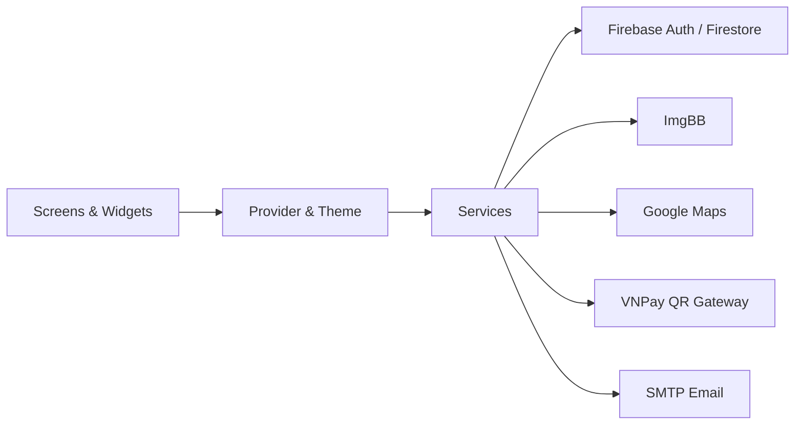

<div align="center">
  
  <h1>SmurfBike</h1>
  <p>Ứng dụng Flutter quản lý xe máy, khách hàng, đơn thuê và thanh toán.</p>

  <p>
    
    
    
  </p>
</div>


## Mục lục

- [Giới thiệu](#giới-thiệu)
- [Tính năng](#tính-năng)
- [Kiến trúc](#kiến-trúc)
- [Công nghệ](#công-nghệ)
- [Yêu cầu](#yêu-cầu)
- [Cài đặt](#cài-đặt)
- [Cấu hình](#cấu-hình)
- [Chạy ứng dụng](#chạy-ứng-dụng)
- [Cấu trúc thư mục](#cấu-trúc-thư-mục)

## Giới thiệu

SmurfBike là ứng dụng Flutter dành cho quy trình vận hành dịch vụ cho thuê xe máy. Ứng dụng kết nối Firebase Authentication và Cloud Firestore với các service nghiệp vụ trong `lib/services`, đồng thời hỗ trợ Android, iOS, web và các desktop target được Flutter quản lý trong repository.

Giao diện hỗ trợ tiếng Việt và tiếng Anh, light mode và dark mode. Tên hiển thị native hiện được cấu hình là `SmurfBike`.

## Tính năng

- **Xác thực và tài khoản:** đăng nhập, đặt lại mật khẩu, quản lý hồ sơ người dùng và tài khoản nhân viên.
- **Quản lý danh mục:** thêm, sửa, xóa và cập nhật trạng thái xe; quản lý thương hiệu xe.
- **Quản lý khách hàng:** tra cứu người dùng và lịch sử thuê xe.
- **Quản lý đơn thuê:** tạo, xem chi tiết và cập nhật vòng đời đơn thuê.
- **Bản đồ và vị trí:** hiển thị vị trí xe bằng Google Maps và lấy vị trí thiết bị qua `geolocator`.
- **QR:** quét mã QR và tạo dữ liệu QR cho các luồng trong ứng dụng.
- **Thanh toán:** ghi nhận thanh toán tiền mặt và tạo dữ liệu thanh toán VNPay QR thông qua payment service/gateway hiện có.
- **Báo cáo:** tạo và chia sẻ báo cáo PDF bằng `pdf`, `printing`, `share_plus` và `path_provider`.
- **Thông báo và email:** tạo thông báo trong Firestore, hiển thị local notification và gửi email qua SMTP.
- **Đa ngôn ngữ và giao diện:** dùng `easy_localization`, `provider` và bộ theme trong `lib/config/theme.dart`.
- **Lưu trữ ảnh:** upload ảnh và chữ ký lên ImgBB thông qua `StorageService`.

## Kiến trúc



Điểm khởi chạy nằm ở `lib/main.dart`. Ứng dụng khởi tạo localization, `.env`, Firebase và local notifications trước khi dựng `MaterialApp`. Các route chính được khai báo trong `lib/config/routes.dart`.

## Công nghệ

| Nhóm | Thành phần |
| :--- | :--- |
| Framework | Flutter |
| Ngôn ngữ | Dart `^3.7.2` |
| Backend | Firebase Core, Firebase Authentication, Cloud Firestore |
| State & localization | Provider, Easy Localization |
| Bản đồ & vị trí | Google Maps Flutter, Geolocator |
| Thanh toán & QR | VNPay QR flow, `qr_flutter`, `qr_code_scanner_plus` |
| Báo cáo & chia sẻ | PDF, Printing, Share Plus |
| Thông báo & email | Flutter Local Notifications, Timezone, Mailer |
| Lưu trữ ảnh | ImgBB API |

## Yêu cầu

- Flutter SDK có Dart SDK thỏa `^3.7.2`.
- Một thiết bị hoặc emulator/simulator tương thích với target cần chạy.
- Một Firebase project đã bật Authentication, Firestore và Storage cho các luồng tương ứng.
- API key Google Maps nếu sử dụng tính năng bản đồ.
- SMTP credentials và ImgBB API key nếu sử dụng email hoặc upload ảnh.

## Cài đặt

### 1. Clone và cài dependencies

```bash
git clone https://github.com/dexter826/motorbike_rental_app.git
cd motorbike_rental_app
flutter pub get
```

### 2. Tạo cấu hình Firebase

Tạo Firebase project rồi tạo các file cấu hình từ file mẫu:

```bash
cp lib/firebase_options.dart.example lib/firebase_options.dart
cp android/app/google-services.json.example android/app/google-services.json
cp ios/Runner/GoogleService-Info.plist.example ios/Runner/GoogleService-Info.plist
```

Thay các giá trị mẫu trong các file vừa tạo bằng cấu hình Firebase của project. Chỉ tạo file iOS trên macOS khi build target iOS.

### 3. Tạo biến môi trường

```bash
cp .env.example .env
```

Điền các biến cần thiết trong `.env` theo bảng [Cấu hình](#cấu-hình).

## Cấu hình

`lib/main.dart` tải `.env` từ thư mục gốc khi ứng dụng khởi động. Các biến được khai báo trong `.env.example`:

| Biến | Bắt buộc cho | Mô tả |
| :--- | :---: | :--- |
| `EMAIL_USERNAME` | Email | Tài khoản SMTP gửi email |
| `EMAIL_PASSWORD` | Email | App password hoặc credential SMTP |
| `EMAIL_HOST` | Email | SMTP host; code dùng `smtp.gmail.com` nếu bỏ trống |
| `EMAIL_PORT` | Email | SMTP port; code dùng `587` nếu bỏ trống |
| `COMPANY_NAME` | Email | Tên hiển thị trong email |
| `GOOGLE_MAPS_API_KEY` | Bản đồ | API key được đọc bởi `ConfigService` |
| `IMGBB_API_KEY` | Upload ảnh/chữ ký | API key cho ImgBB |

Không commit `.env`, `lib/firebase_options.dart`, `android/app/google-services.json`, `ios/Runner/GoogleService-Info.plist`, `android/gradle.properties` hoặc `ios/Config.xcconfig`. Các file này đã được loại khỏi Git theo `.gitignore`.

### Cấu hình Google Maps native

Ngoài `.env`, Google Maps native đọc key từ:

- Android: tạo `android/gradle.properties` từ `android/gradle.properties.example`.
- iOS: tạo `ios/Config.xcconfig` từ `ios/Config.xcconfig.example`.

## Chạy ứng dụng

Kiểm tra target có sẵn:

```bash
flutter devices
```

Chạy target mặc định hoặc chỉ định target cụ thể:

```bash
flutter run
flutter run -d <device-id>
```

Build các target được Flutter hỗ trợ:

```bash
flutter build apk --release
flutter build ios --release
flutter build web --release
```

`flutter build ios` yêu cầu macOS và Xcode.

## Cấu trúc thư mục

```text
.
|-- android/                 # Cấu hình và mã native Android
|-- assets/                  # Hình ảnh, animation, font và bản dịch
|-- ios/                     # Cấu hình và mã native iOS
|-- lib/
|   |-- config/              # Route và theme
|   |-- models/              # Bike, Rental, User, Payment...
|   |-- providers/           # State management
|   |-- screens/             # Màn hình theo module nghiệp vụ
|   |-- services/            # Firebase, payment, email, storage, report...
|   |-- utils/               # Helper dùng chung
|   |-- widgets/             # Widget tái sử dụng
|   `-- main.dart            # Application entrypoint
|-- test/                    # Widget tests
|-- web/                     # Web assets và manifest
|-- windows/                 # Windows runner
|-- linux/                   # Linux runner
|-- macos/                   # macOS runner
|-- .env.example             # Mẫu biến môi trường
|-- pubspec.yaml             # Dependencies và asset declarations
`-- README.md
```
